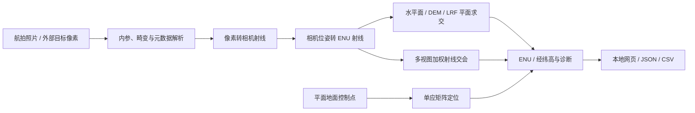

# UAV Visual 3D Localization

**无人机视觉目标高精度 3D 定位算法** · [English](README.en.md)

将航拍图像中的目标像素或检测框转换为局部 ENU 坐标及经纬高。项目提供单图地面约束定位、多视图射线交会、激光测距（LRF）高度平面拟合，以及本地浏览器交互界面与 JSON / CSV 命令行接口。

主要面向航拍目标定位、道路桥梁场景的点位分析和算法验证。目标像素由人工点选或外部检测器提供；当前实现以照片与元数据处理为主。


## 功能

| 模块 | 输入与约束 | 输出 |
| --- | --- | --- |
| 单图平面定位 | 相机内参、位姿、像素 / 检测框、已知地面高度 | 射线与水平面的交点 |
| GCP 单应定位 | 至少 4 个平面控制点 | 地面坐标、拟合与检查点残差 |
| DEM 定位 | 相机模型与规则格网高程 | 射线与地形的交点 |
| 多视图定位 | 多张照片中同一静止物理点 | 加权最小二乘 3D 交会、残差与几何质量诊断 |
| LRF 平面 | 至少 3 个有效测距落点 | 局部高度模型及像素定位结果 |
| 交互界面 | 本地照片与可用的 EXIF / DJI XMP | 点选定位、AGL / LRF 高度结果比较、多照片交会 |

## 系统流程



坐标与算法约定见 [架构说明](docs/ARCHITECTURE.md)，数据准备见 [数据说明](docs/DATA.md)。

## 快速开始

已验证环境：Windows x64、Python 3.13、NumPy 2.1.3、Flask 3.1.0、Pillow 11.3.0。依赖版本见 `完整代码/requirements.txt`。

```powershell
git clone https://github.com/xmuzr/uav-visual-3d-localization.git
cd uav-visual-3d-localization
python -m venv .venv
.venv\Scripts\Activate.ps1
python -X utf8 -m pip install -r requirements.txt
python -B 完整代码/run.py
```

浏览器会打开 <http://127.0.0.1:5050>。独立多帧界面使用：

```powershell
python -B 完整代码/run.py --multi
```

多帧地址为 <http://127.0.0.1:5051>。可用 `--port 5060` 更改端口，`--no-browser` 关闭自动打开浏览器。按 `Ctrl+C` 停止服务。

Windows 用户也可进入 `完整代码`，双击 `安装依赖.cmd`，随后运行 `启动.cmd` 或 `启动多帧.cmd`。安装器优先使用本地离线 wheel；公开仓库未附带 wheel 时会联网安装。

公开仓库保留空的 `数据集/原始照片/` 目录。把自己的照片放入该目录，或在界面中选择本地照片目录；若需要补充 DJI 元数据，可在本地放置 `数据集/dji.md`。原始航拍数据与验收资料不随公开仓库分发。

## 无需照片的可复现演示

以下命令可直接在公开仓库运行：

```powershell
python -B examples/synthetic_demo.py
python -B 完整代码/locate_cli.py --config 完整代码/input_plane_pose_example.json
python -B 完整代码/locate_cli.py --config 完整代码/input_planar_gcps_example.json
python -B scripts/check_repository.py
```

合成演示使用已知目标、3 个虚拟相机和人为定义的斜平面，验证单图、多视图和 LRF 平面三个计算链路，并展示固定随机种子的像素扰动结果。输出示例见 [synthetic_result.json](examples/synthetic_result.json)，验证范围见 [VALIDATION.md](docs/VALIDATION.md)。

保存命令行结果：

```powershell
python -B 完整代码/locate_cli.py --config 完整代码/input_plane_pose_example.json --output result.json
python -B 完整代码/locate_cli.py --config 完整代码/input_planar_gcps_example.json --output result.csv
```

`input_multi_view_intersection_example.json` 和 `input_lrf_height_plane_example.json` 是原采集流程的配置模板，需要自行提供照片、核对元数据，并替换同名点像素后运行；它们不属于开箱即用的实测结果。

## 仓库结构

```text
uav-visual-3d-localization/
├── README.md / README.en.md
├── requirements.txt
├── 完整代码/
│   ├── image_localization.py       # 相机、平面、DEM、GCP 与坐标转换
│   ├── multi_view_localization.py  # 射线交会与 LRF 平面
│   ├── locate_cli.py / multi_view_cli.py
│   ├── photo_localizer_app.py / multi_view_app.py
│   ├── run.py
│   ├── input_*_example.json
│   └── templates/ / static/
├── examples/                       # 无真实数据依赖的合成演示与输出
├── scripts/                        # 发布检查
├── docs/                           # 架构、数据与验证说明
└── 数据集/原始照片/                # 本地照片放置目录，图像被 Git 忽略
```

保留原交付目录及模块名，便于与本地项目对照。

## 使用边界

- 单图平面法依赖地面模型；坡面、立体物体和错误高程会造成系统偏差。
- 多视图需点击同一静止物理点，近乎平行的射线会使几何条件恶化。
- LRF 点可能落在树冠、立面或其他表面，使用前需检查有效性与拟合残差。
- 地理高度、相对高度和地面高度必须使用一致的基准。
- 射线残差、平面拟合误差与点间距离反映内部一致性。实测定位精度应另用未参与标定的独立检查点评价。
- 网页服务默认仅监听本机，按本地工具使用。


